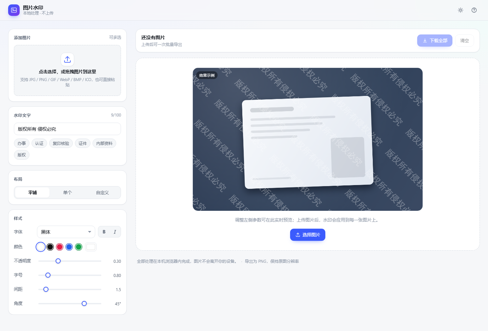

# 图片水印

纯前端、零运行时依赖、完全本地运行的图片水印工具。选图、调参、导出全部在浏览器内完成，**图片不上传、页面不发起任何网络请求**，适合身份证、护照、驾照、合同等敏感图片的打码处理。



**在线使用**：<https://cccgitzh.github.io/photo-watermark/>

> 同一个版本也部署在 EdgeOne Makers（项目 `photo-watermark`）。EdgeOne 默认域名对匿名访客有访问校验，需在控制台点「预览」获取带令牌的链接，详见 [docs/04-deploy.md](docs/04-deploy.md#7-edgeone-makers-部署)。

## 特性

- **完全本地**：解码、绘制、打包都用浏览器原生能力；CSP 中 `connect-src 'none'`，从策略层禁止页面联网
- **三种布局**：平铺 / 单个（居中与四角）/ 自定义数量
- **完整样式**：12 种字体族、粗体斜体、任意颜色、透明度、字号、间距、旋转 -90°~90°
- **批量能力**：多选 / 拖拽 / 粘贴导入，逐张导出或一键打包 ZIP
- **原分辨率导出**：导出 PNG 保持原图像素尺寸，不做降采样
- **实时预览**：未上传时也有示例画布，改参数即时看到效果
- **深色模式**：默认跟随系统，可手动切换并记忆
- **键盘可用**：全流程可键盘操作，预览支持方向键翻页

## 快速开始

项目使用原生 ES Module，需要通过 HTTP 访问（直接双击 `index.html` 会被浏览器的 `file://` 跨域策略拦截）。

```bash
# 方式一：内置零依赖静态服务器（需要 Node 18+）
node scripts/serve.mjs          # http://localhost:8080
node scripts/serve.mjs 3000     # 指定端口

# 方式二：Docker
docker compose up -d            # http://localhost:8080

# 方式三：任意静态服务器
python -m http.server 8080
npx serve .
```

## 使用流程

1. 添加图片：点击上传区、把图片拖进页面，或直接 <kbd>Ctrl</kbd>/<kbd>⌘</kbd>+<kbd>V</kbd> 粘贴
2. 输入水印文字：可直接选常用模板（办事 / 认证 / 证件 / 内部资料等）
3. 选择布局与样式：平铺、单个或自定义数量，再调字体、颜色、透明度、字号、间距、角度
4. 导出：点单张卡片的「下载」或「复制」，或点右上「下载全部」打包 ZIP

## 快捷键

| 快捷键 | 作用 |
| --- | --- |
| `Ctrl`/`⌘` + `V` | 粘贴图片或文字 |
| `Ctrl`/`⌘` + `D` | 下载全部 |
| `Ctrl`/`⌘` + `Z` | 撤销删除 / 清空 |
| `←` `→` | 预览时切换图片（触屏可左右滑动） |
| `Esc` | 关闭预览 |
| `1`–`9` | 快速调整字号 |

## 目录结构

```
index.html              页面骨架
css/                    样式（设计令牌 / 布局 / 组件）
js/                     应用代码（ES Module，按职责拆分）
assets/icon.svg         站点图标
scripts/serve.mjs       零依赖本地静态服务器
tests/                  单元测试与回归基准（Node 内置 test runner）
docs/                   分析、升级说明、文件清单、部署步骤
```

详见 [docs/03-structure.md](docs/03-structure.md)。

## 测试

```bash
node --test
```

测试覆盖：水印几何与旧版逐字等价、换行规则回归、ZIP 结构回环校验（CRC / 解压 / UTF-8 文件名）。

## 浏览器支持

Chrome / Edge 103+、Safari 16.4+、Firefox 113+。

批量打包依赖 `CompressionStream('deflate-raw')`；不支持时自动退化为「仅存储」打包，产物仍是合法 ZIP。

## 隐私说明

- 页面不包含任何第三方脚本、字体、CDN 资源，也不发起网络请求
- 图片仅存在于当前标签页内存中，关闭页面即释放
- 仅主题与参数偏好写入本机 `localStorage`，不含任何图片信息

## 许可

GPL-3.0，见 [LICENSE](LICENSE)。本项目为衍生作品，界面与绘制算法源自上游开源实现，重构后仍以同一许可发布。
